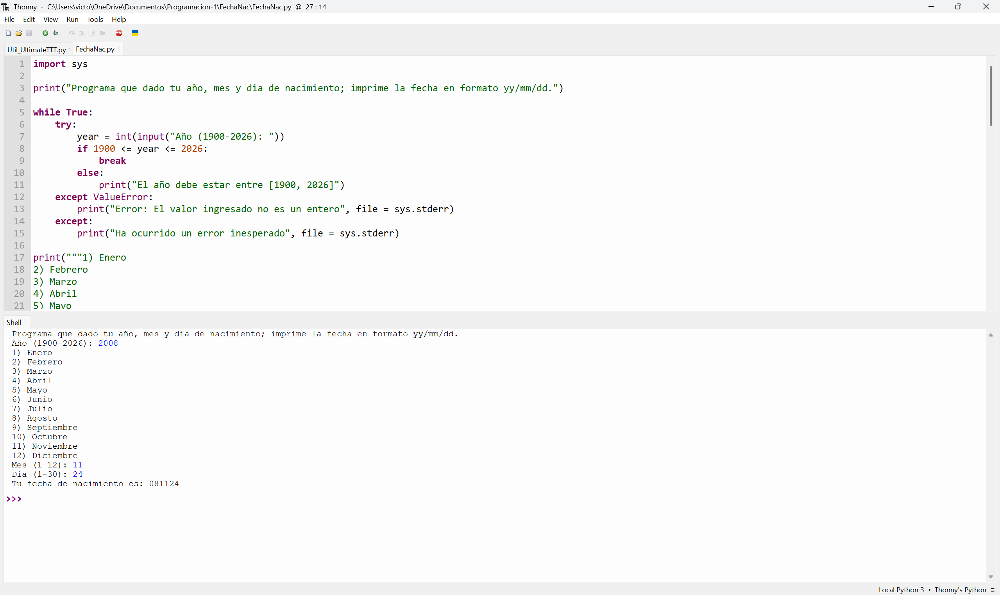

# Programación 1

Este repositorio contiene algunos programas y ejercicios
desarrollados durante la materia de Programación 1.

Los ejercicios están organizados por temas, y cada
programa se encuentra en su propia carpeta.

## Contenido

| BlackJack | El juego original del BlackJack |
| --- | --- |
| `BlackJack/BlackJack.py` | Juego de apuestas de un jugador, donde tienes que intentar conseguir la mayor puntuación sin pasarte de 21 puntos. |

| Figuras | Crear y mostrar figuras |
| --- | --- |
| `Figuras/Figuras.py` | Programa que imprime algunas figuras con las caracteristicas indicadas. |

| Gato | El juego del gato |
| --- | --- |
| `Gato/Gato.py` | Juego del gato de 2 jugadores, donde el objetivo es conseguir 3 en raya. |

| Ordenamientos | Programa que ordena un arreglo de datos generados al azar |
| --- | --- |
| `Ordenamientos/Ordenamientos.py` | Programa que muestra de manera grafica como funcionan los distintos algoritmos de ordenamiento. |

| PromedioAlumnos | Programa calcula el promedio de una lista de alumnos |
| --- | --- |
| `PromedioAlumnos/PromedioAlumnos_3.py` | Programa que captura el nombre y calificación de distintos alumnos, y al final indica su promedio general e indica los que obtuvieron calificaciones sobresalientes. |

| FechaNaz | Programa que capturar tu fecha de nacimiento |
| --- | --- |
| `FechaNac/FechaNac.py` | Programa que captura y valida tu fecha de nacimiento, luego la imprime con el formato: yy/mm/dd. |

## Ejecución del programa

### Gato

Juego del gato de 2 jugadores, donde el objetivo es conseguir 3 en raya.

**Requisitos:**
- Tener instalado Python 3.

**Ubicacion:** `Gato/Gato.py`

**Para ejecutarlo:**

```bash
python3 Gato/Gato.py
```

## Ejemplo de funcionamiento

Al ejecutar `FechaNac/FechaNac.py`, el programa solicita tu año, mes y dia de nacimiento.

**Ejemplo de entrada y salida:**

```text
Año (1900-2026): 2008
1) Enero
2) Febrero
3) Marzo
4) Abril
5) Mayo
6) Junio
7) Julio
8) Agosto
9) Septiembre
10) Octubre
11) Noviembre
12) Diciembre
Mes (1-12): 11
Dia (1-30): 24
Tu fecha de nacimiento es: 081124
```



## Autor
Victor Hugo Inda Miramontes